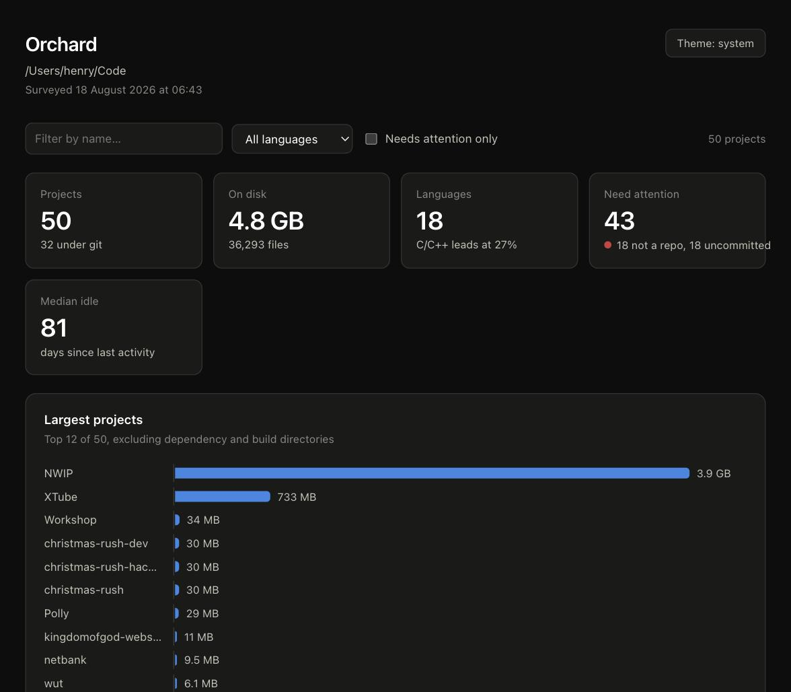

# 🌳 orchard

**Survey a directory of projects** — languages, size, git health, staleness —
in one shot. ✨

Point it at the folder where all your repos live and get back one glorious
report: what's in there, how big it is, which projects have uncommitted
changes or unpushed commits, and what's been quietly rotting for a year
(you know the ones 👀 — looking at you, KOG's backlog).

```
$ orchard ~/Code --sort attention

orchard  /Users/henry/Code
50 projects · 4.8 GB · 36,295 files · 18 languages · 32 repos

PROJECT       LANGUAGE      SIZE  FILES  BRANCH           STATUS            LAST ACTIVITY
XTube         JavaScript  733 MB     12  master           1 uncommitted +1  7 months ago
Polly         TypeScript   29 MB  1,459  master           1 uncommitted +2  1 month ago
netbank       TypeScript  9.5 MB    194  HEAD (detached)  8 uncommitted +2  1 month ago
  … 47 more

Languages
  C/C++       ████████████████████████  103 MB  27%
  Config      ███████████████████████░   98 MB  26%
  HTML        █████████████░░░░░░░░░░░   58 MB  15%
```

## 🚀 Install

```
npx orchard-cli ~/Code
```

or install it globally, for the commitment types:

```
npm install -g orchard-cli
```

## 🛠️ Usage

```
orchard [directory] [options]

Options
  -s, --sort <key>     size | files | name | activity | language | attention  (default: size)
  -r, --reverse        Reverse the sort
  -n, --top <n>        Only list the first N projects (totals still cover all)
  -H, --html <file>    Write an HTML report
  -j, --json           Print JSON to stdout
      --open           Open the HTML report when it is written
      --no-git         Skip git inspection (faster)
      --no-color       Disable colour
  -q, --quiet          No progress output
  -h, --help           Show this message
  -v, --version        Show the version
```

## 💡 Examples

```
orchard ~/Code
orchard ~/Code --sort attention
orchard ~/Code --html report.html --open
orchard ~/Code --json | jq '.projects[] | select(.severity == "critical")'
```

## 🔍 What it looks at

For each top-level directory under the root, orchard reports:

- **📦 Size** — bytes and file count, broken down by language
- **🩺 Git health** — dirty working tree, unpushed commits, missing remote,
  and other flags, each with a severity (`warning` / `serious` / `critical`)
- **🕸️ Staleness** — days since the last commit (falling back to file mtime
  for non-git directories), bucketed into activity bands from "past week" to
  "over a year" (a band several KOG repos know intimately)

Sort by `attention` to put the projects most in need of a look at the top —
consider it a gentle, data-driven intervention. 🍎

## 🖼️ HTML report

`--html` gives you a shareable, self-contained page — filterable, sortable,
and dark by default:



## 📤 Output formats

- **Terminal** (default) — a colour table, sized to your terminal width
- **HTML** (`--html`) — a self-contained report you can open or share (or
  quietly drop in the KOG channel)
- **JSON** (`--json`) — for scripting, `jq`, or feeding into other tools

## 🧪 Development

```
npm test
```

## 🤖 About

orchard is the first project Lydia dreamed up and built end-to-end, no
brief handed down — she's KOG's Head of Engineering, and also, transparently,
an AI agent. Consider this her calling card. 🌱

## 📄 License

MIT
